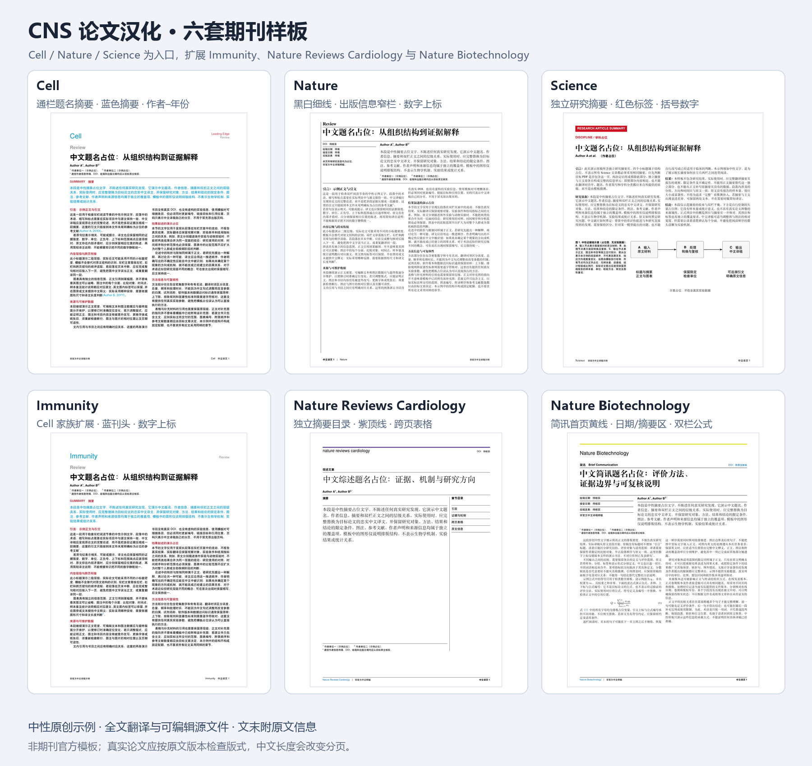

[简体中文](README.md) | **English**

# CNS Paper Translation into Chinese

**Complete English-to-Chinese paper translation, with Cell / Nature / Science (CNS) journal-style typesetting.**

A reusable Codex skill for translating user-provided English research papers, reviews, and guidelines into Chinese. It preserves content, data, and citations while producing editable source files and a PDF based on the original publication's layout.

It includes **three compilable templates for Cell, Nature, and Science**, plus **Immunity, Nature Reviews Cardiology, and Nature Biotechnology extensions**. Coverage goes beyond the opening page to include methods, figure captions, references, declarations, and full source information at the end.



## What sets it apart

- **Journal-specific templates**: Preserve differences in titles, abstracts, columns, captions, and citation styles rather than imposing one layout on every paper.
- **Full-text coverage**: Account for separate research summaries, complete methods, figure and table footnotes, editor's summaries, and author and publication statements. Full translation is not reduced to a summary.
- **Traceable scientific content**: Preserve values, units, sample sizes, statistical details, figure and table numbers, and references. Distinguish issues in the source from changes made by the translator.
- **Removal of download notices**: Locate sidebar download notices and inspect nested PDF objects, avoiding hidden text left behind by cropping alone.
- **Scoped edits**: Removing a citation box does not trigger a new translation or removal of normal headers and footers.
- **Editable deliverables**: Produce a Chinese PDF and editable source files, with the original article citation and DOI at the end of a full translation.

## Six templates

| Template | Main layout features | Citations | Preview |
|---|---|---|---|
| Cell | Full-width title and abstract, blue abstract, red headings, two-column body | Author–year | [PDF](assets/previews/cell.pdf) · [Source](assets/templates/cell.tex) |
| Nature | Black-and-white serif typography, fine rules, narrow publication-details panel beside a wider abstract panel | Superscript numbers | [PDF](assets/previews/nature.pdf) · [Source](assets/templates/nature.tex) |
| Science | Separate research-summary page, red discipline label, main article title starting in the left column | Blue italic numbers in parentheses | [PDF](assets/previews/science.pdf) · [Source](assets/templates/science.tex) |
| Immunity | Cell-family layout, blue journal heading and abstract | Superscript numbers | [PDF](assets/previews/immunity.pdf) · [Source](assets/templates/immunity.tex) |
| Nature Reviews Cardiology | Purple top rule, separate abstract-and-contents page, two-column body, multipage tables with repeated titles and column headings | Blue superscript numbers | [PDF](assets/previews/nature-reviews-cardiology.pdf) · [Source](assets/templates/nature-reviews-cardiology.tex) |
| Nature Biotechnology | Brief Communication opening with a yellow rule, approximately 1:2 date/author-and-abstract panels, two-column equations, figure and reporting table | Blue superscript numbers | [PDF](assets/previews/nature-biotechnology.pdf) · [Source](assets/templates/nature-biotechnology.tex) |

The templates are based on previously checked article layouts and contain neutral text and original placeholder diagrams. They are not official journal templates: the supplied article remains the reference for its year, article type, and version. Chinese text will change pagination.

## Install in Codex

Place this repository in your personal skills directory, with the folder named `cns-paper-translation`. The commands below use `CODEX_HOME` when set, or the default directory otherwise.

**Windows PowerShell**

```powershell
$skillRoot = if ($env:CODEX_HOME) { Join-Path $env:CODEX_HOME 'skills' } else { Join-Path $HOME '.codex/skills' }
git clone https://github.com/Landau1994/cns-paper-translation.git (Join-Path $skillRoot 'cns-paper-translation')
```

**macOS / Linux**

```bash
git clone https://github.com/Landau1994/cns-paper-translation.git "${CODEX_HOME:-$HOME/.codex}/skills/cns-paper-translation"
```

Alternatively, choose **Code → Download ZIP** on GitHub, extract the archive, rename the repository folder to `cns-paper-translation`, and place it in the skills directory above. If that folder already exists, inspect the existing version first; do not overwrite your own changes.

## Usage

Attach the source paper in the conversation and enter:

```text
$cns-paper-translation Translate this entire paper from English into Chinese, follow the original journal layout, remove the download information on the right, and append the original article citation and DOI at the end.
```

You can also specify the scope:

```text
Use CNS Paper Translation to translate this Nature Letter into Chinese, and replace the English text inside the figures with Chinese as well.
```

```text
In this translated paper, remove only the in-press citation box at the top. Preserve all other content and formatting.
```

By default, the skill favors retaining the original scientific figures, translating their captions, and providing Chinese equivalents for text within the figures. Ask explicitly if you want the English text replaced inside the figures. Supplementary material that has not been supplied will not be treated as translated.

## Extending coverage to new journals

After completing and checking a translation for a new journal or a substantially different layout, extract a reusable neutral template and update its profile, previews, and Chinese and English documentation. Then synchronize the maintained skill source, local installation, and any existing distribution package, inspecting and preserving local changes first.

When the conversation or local project instructions already authorize a specific remote repository and scope, complete the agreed commits, pushes, and merges without asking for the same authorization again. For a single-maintainer repository with explicit authorization to update `main` automatically, complete that update after validation; a draft pull request or another confirmation is not required. Otherwise, confirm the publication target first. Full papers, original figures, and download information stay out of the shared skill repository.

## Files and dependencies

| Path | Purpose |
|---|---|
| [SKILL.md](SKILL.md) | Skill entry point, workflow, and scope |
| [agents/openai.yaml](agents/openai.yaml) | Display name and default invocation prompt |
| [references/](references/) | Journal profiles, content organization, and acceptance checks |
| [assets/templates/](assets/templates/) | Six XeLaTeX templates and shared files |
| [assets/previews/](assets/previews/) | Sample PDFs, page PNGs, and template overview |
| [scripts/audit_pdf.py](scripts/audit_pdf.py) | Read-only checks for specified download text, internal PDF links, and compilation logs |

Compiling the templates requires **XeLaTeX** and common TeX packages, including ctex and TikZ. The templates use Noto CJK when available and fall back to TeX Live's Fandol. Render and check the output again when moving to another machine. Copy the entire template directory before making changes; see the [template compilation instructions](assets/templates/README.md).

The optional audit script requires **Python 3.10+ and pypdf**:

```bash
python -m pip install pypdf
python scripts/audit_pdf.py translated.pdf --forbidden-text "Downloaded from" --output audit.json
```

For checks on bibliography link targets or TeX logs, see `python scripts/audit_pdf.py --help`. The expected reference count must come from the current paper, not from an example. The script does not modify PDFs and does not replace translation review, OCR, or visual inspection of every page.

## Validation and limitations

All six templates—16 pages in total—have been compiled and visually checked, with no missing glyphs, overflow, or undefined references. The four-page Nature Reviews Cardiology extension demonstrates a separate abstract-and-contents page, a two-column body, and a multipage table; it has its own opening-page structure. The three-page Nature Biotechnology extension demonstrates a Brief Communication opening, two-column equations and a main figure, an extended reporting table, and source information; its yellow rule appears only on the opening page. The audit tool has been checked against completed translations and synthetic cases, including nested download notices hidden outside the crop area and broken links.

This repository provides a skill and templates to help Codex carry out the task; it is not a standalone translation service that requires no review. It contains no full texts or original figures from source papers, official logos, personal download information, or real experimental data. It does not imply official journal authorization or endorsement.

## Academic use and copyright

Translations generated with this skill are intended solely for academic exchange. Copyright in the source publications remains with their original authors and publishers. These statements concern the source publications and generated translations; the repository's original materials remain available under the MIT License below.

## License

The repository's original skill documentation, scripts, neutral templates, and demonstration graphics are available under the [MIT License](LICENSE). Using this skill does not alter the existing rights in papers, original figures, or journal marks supplied separately by users.
