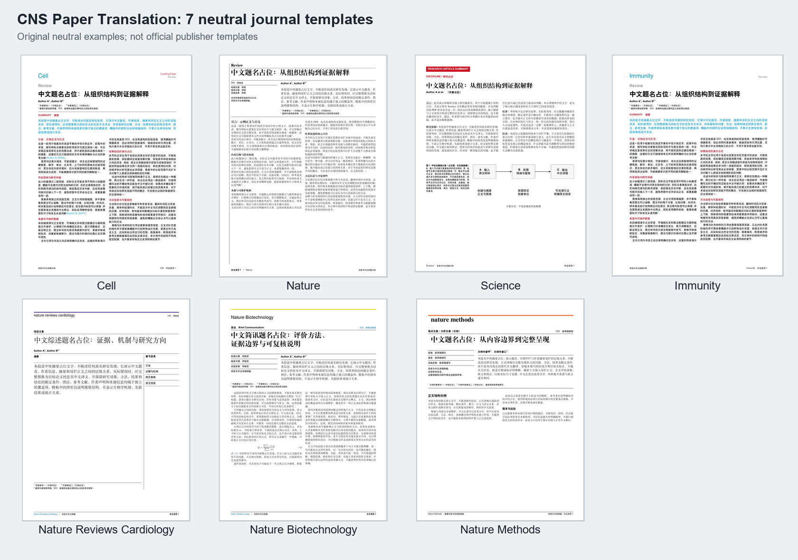

**简体中文** | [English](README.en.md)

# CNS 论文汉化

**全文汉化 + CNS 期刊风格排版。**

一个面向 Codex 的可复用技能：将用户提供的英文论文、综述或指南译成中文，保留内容、数据与引文，并参照原刊结构生成可编辑稿和 PDF。

以 **Cell、Nature、Science 三套可编译样板**为特色，附 **Immunity、Nature Reviews Cardiology、Nature Biotechnology 与 Nature Methods 扩展**。不只关注首页效果，也覆盖方法、图注、书目、声明和文末原文信息。



## 有什么不同

- **有样板的期刊排版**：分别保留题名、摘要、双栏、图注与引文形式的差异，不把所有论文套进同一个版面。
- **全文覆盖**：关注独立研究摘要、完整方法、图表脚注、编辑摘要以及作者与出版声明；不把全文翻译压缩成内容总结。
- **可追溯的科学内容**：保留数值、单位、样本量、统计信息、图表编号与参考文献；原文疑点和译者修订分开说明。
- **清除下载来源信息**：定位旁栏下载标记，并检查嵌套 PDF 对象，避免仅裁边后留下隐藏文字。
- **局部修改保持范围**：只删引用框时，不重译正文或顺带删除正常页眉页脚。
- **便于继续修改**：交付中文 PDF、可编辑源文件，并在全文末尾附原文引用与 DOI。

## 七套样板

| 样板 | 主要视觉结构 | 引文 | 演示 |
|---|---|---|---|
| Cell | 通栏题名摘要、蓝色摘要、红色层级、双栏正文 | 作者—年份 | [PDF](assets/previews/cell.pdf) · [源文件](assets/templates/cell.tex) |
| Nature | 黑白衬线、细线、出版信息窄栏与摘要宽栏 | 数字上标 | [PDF](assets/previews/nature.pdf) · [源文件](assets/templates/nature.tex) |
| Science | 独立研究摘要页、红色学科标签、正文左栏起题名 | 蓝色斜体括号数字 | [PDF](assets/previews/science.pdf) · [源文件](assets/templates/science.tex) |
| Immunity | Cell 家族结构、蓝色刊头与摘要 | 数字上标 | [PDF](assets/previews/immunity.pdf) · [源文件](assets/templates/immunity.tex) |
| Nature Reviews Cardiology | 紫色顶线、独立摘要目录页、双栏正文、跨页表重复标题与列头 | 蓝色数字上标 | [PDF](assets/previews/nature-reviews-cardiology.pdf) · [源文件](assets/templates/nature-reviews-cardiology.tex) |
| Nature Biotechnology | 简讯首页黄色顶线、约1:2日期/作者摘要区、双栏公式、图文与报告表 | 蓝色数字上标 | [PDF](assets/previews/nature-biotechnology.pdf) · [源文件](assets/templates/nature-biotechnology.tex) |
| Nature Methods | 橙色首页顶线、约1:2日期/作者摘要区、双栏、通栏表格/框文/图像 | 蓝色数字上标 | [PDF](assets/previews/nature-methods.pdf) · [源文件](assets/templates/nature-methods.tex) |

样板来自已核验文章的版式提炼，使用中性文字和原创示意占位图。它们不是期刊官方模板；不同年代、文体和版本仍需以实际原稿为准。中文长度会改变分页。

## 安装到 Codex

将本仓库放入个人技能目录，并将文件夹命名为 `cns-paper-translation`。使用默认目录时：

**Windows PowerShell**

```powershell
$skillRoot = if ($env:CODEX_HOME) { Join-Path $env:CODEX_HOME 'skills' } else { Join-Path $HOME '.codex/skills' }
git clone https://github.com/Landau1994/cns-paper-translation.git (Join-Path $skillRoot 'cns-paper-translation')
```

**macOS / Linux**

```bash
git clone https://github.com/Landau1994/cns-paper-translation.git "${CODEX_HOME:-$HOME/.codex}/skills/cns-paper-translation"
```

也可以使用 GitHub 的 **Code → Download ZIP**，解压后把仓库目录改名为 `cns-paper-translation`，放入上述技能目录。若目标目录已经存在，先检查现有版本，不要直接覆盖自己的修改。

## 如何使用

在对话中附上原文，并输入：

```text
$cns-paper-translation 完整汉化这篇论文，参照原刊版式，去除右侧下载信息，并在文末附原文引用和 DOI。
```

也可以指定范围：

```text
用 CNS 论文汉化处理这篇 Nature Letter，图中的英文也直接替换为中文。
```

```text
这篇译文只去掉顶部 in-press 引用框，其他内容和版式保留。
```

默认优先保留科学原图，翻译图注并附图内文字的中文释义。若希望直接替换图内英文，请明确说明。未提供的补充材料不会被当作已翻译内容。

## 新期刊扩展

新期刊或明显不同的版式完成汉化并通过核对后，将可复用结构整理为中性模板，更新配置、预览和中英文说明，再同步项目技能源、本地安装及已有分享包。已有修改先检查并合并。

若会话或项目本地规范已授权具体远程仓库与范围，继续按约定完成提交、推送与合并，无需重复确认。对于已授权自动更新 `main` 的单人维护仓库，检查通过后完成主分支同步，不强制草稿 PR 或额外确认；没有授权时先确认发布目标。论文全文、原图与下载信息不进入共享技能仓库。

## 文件与依赖

| 路径 | 用途 |
|---|---|
| [SKILL.md](SKILL.md) | 技能入口、工作流程与范围 |
| [agents/openai.yaml](agents/openai.yaml) | 显示名称与默认调用提示 |
| [references/](references/) | 期刊配置、内容组织和验收方法 |
| [assets/templates/](assets/templates/) | 七套 XeLaTeX 样板及共享文件 |
| [assets/previews/](assets/previews/) | 演示 PDF、页面 PNG 与样板总览 |
| [scripts/audit_pdf.py](scripts/audit_pdf.py) | 只读检查 PDF 下载词条、内部链接和编译日志 |

编译样板需要 **XeLaTeX** 及 ctex、TikZ 等常见 TeX 包。字体优先使用 Noto CJK，缺少时回退至 TeX Live 的 Fandol；换机后需重新渲染核对。请复制整个模板目录后再修改，具体见 [模板编译说明](assets/templates/README.md)。

可选检查脚本需要 **Python 3.10+ 与 pypdf**：

```bash
python -m pip install pypdf
python scripts/audit_pdf.py translated.pdf --forbidden-text "Downloaded from" --output audit.json
```

需要检查文献目标数量或 TeX 日志时，参见 `python scripts/audit_pdf.py --help`。预期文献数量必须来自当前论文，不能套用示例。脚本不修改 PDF，也不替代人工译文校对、OCR 或逐页视觉检查。

## 验证与边界

七套样板共 19 页已编译并完成视觉检查，无缺字、越界和未定义引用。Nature Reviews Cardiology 扩展用 4 页展示摘要目录、双栏及跨页表格；它不沿用普通 Nature 综述的首页结构。Nature Biotechnology 扩展用 3 页展示简讯首页、双栏数学与主图、扩展报告表及原文信息；其黄色顶线仅用于首页。Nature Methods 扩展以3页展示观点／分析文章首页、通栏表格与框文、图及完整图注，橙色顶线仅用于首页；未填写的在线日期不推断补全。检查工具已用真实译稿，以及隐藏在裁剪区域外的嵌套下载标记、失效链接等合成样本验证。

这是一套帮助 Codex 执行任务的技能与样板，不是无需校对的独立自动翻译服务。仓库不包含原论文全文、原图、官方 logo、个人下载信息或真实实验数据；也不代表期刊官方授权或认可。

## 学术用途与版权

本技能生成的论文译稿仅供学术交流。相关出版物的版权归原作者及出版商所有。上述声明适用于原出版物及其译稿；本仓库的原创材料仍按下述 MIT 许可证开放。

## 许可证

本仓库的原创技能说明、脚本、中性样板和演示图采用 [MIT License](LICENSE)。用户另行提供的论文、原图与期刊标识不因使用本技能而改变其原有权利归属。
